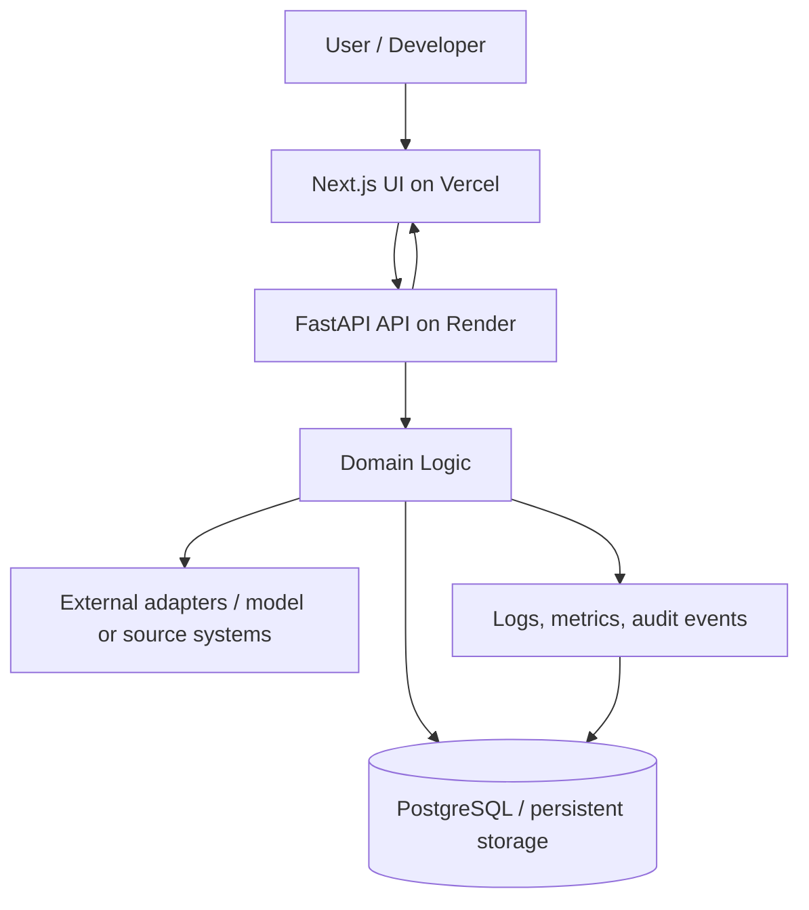
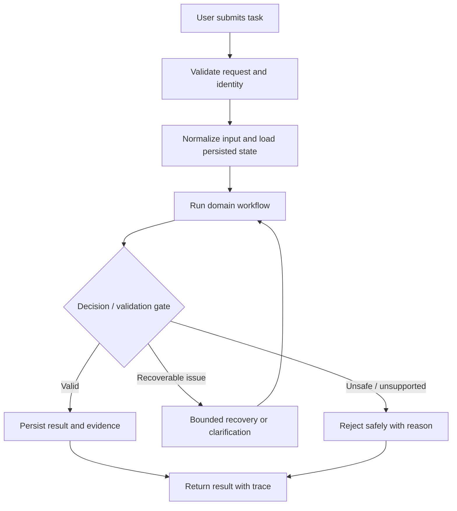
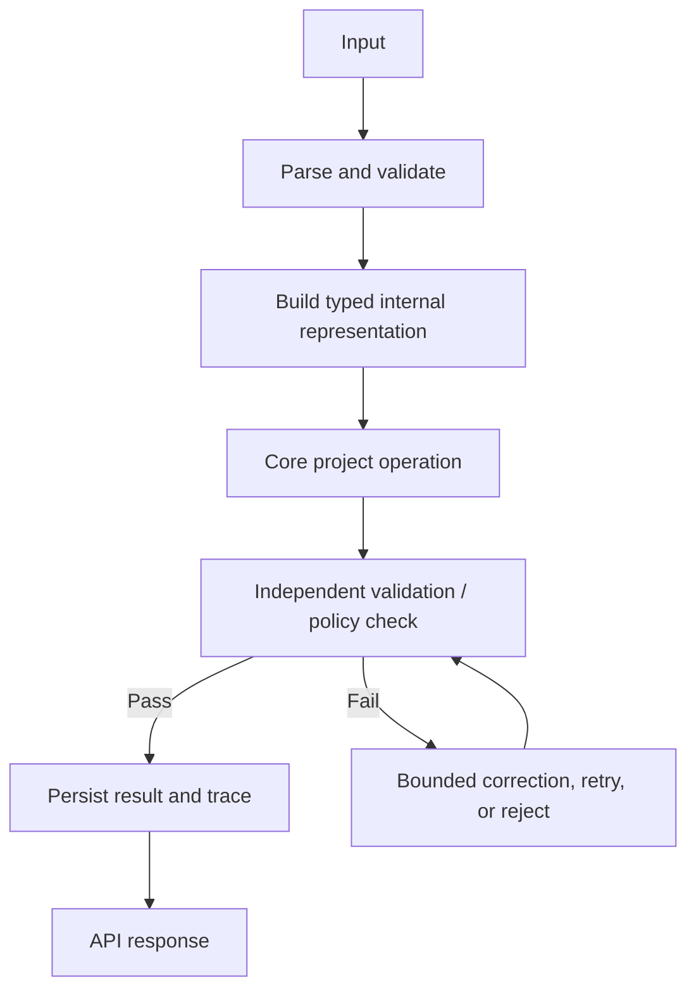
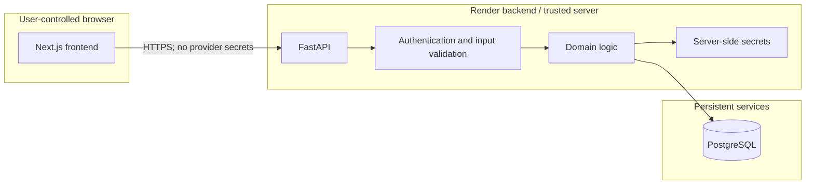
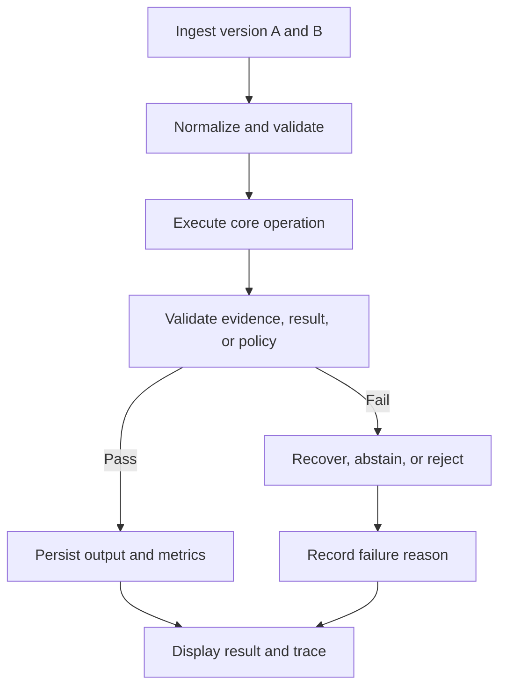
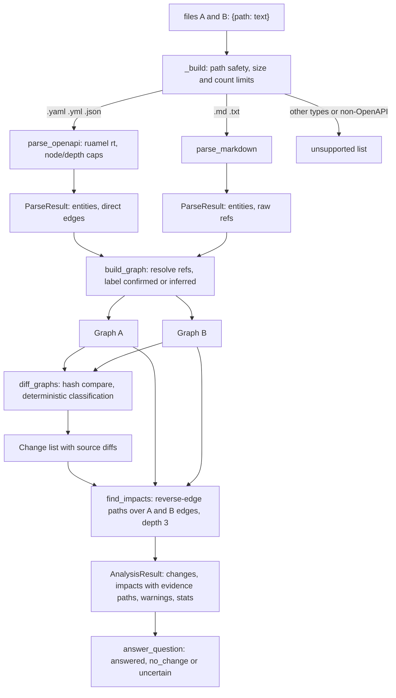
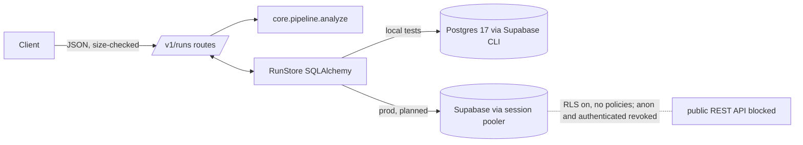
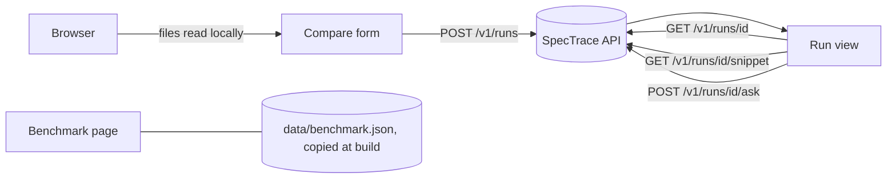

# Design Graph — Version-aware technical documentation retrieval and change-impact analysis

> These graphs describe the intended MVP architecture. Keep them synchronized with the implementation. Mark unimplemented nodes as planned in `State.md`; do not present planned architecture as shipped.

## 1. System context

## 2. High-level request flow

## 3. Detailed project workflow

## 4. Deployment and trust boundaries

## 5. Project-specific workflow

## 6. Implemented core engine data flow (as of 2026-10-16)

Everything in this diagram exists and is unit-tested. Nodes outside it (database, HTTP routes, frontend, benchmark) are planned.

Trust boundary note: every input to `_build` is untrusted. Limits and path checks run before parsing; the only code that interprets YAML is `parsers/openapi.py`.

## Graph maintenance rules

- Update the graph when a component, data contract, trust boundary, state transition, persistence dependency, or external integration changes.
- Add nodes and edges only when grounded in actual code or explicitly labeled as planned.
- Keep diagrams readable; split a graph if it becomes too dense.
- Explain non-obvious edges and failure paths in `Explain.md`.

## Persistence and API flow (implemented 2026-10-16; hosted DB not yet connected to the backend)

Trust boundary: request bodies are untrusted and are size-limited before parsing; the database is
reachable only from the backend. Run states: `running` -> `done` or `failed` (with error code).

Request middleware order (implemented): `CORS -> log_requests -> rate_limit -> limit_body_size -> route`. The rate limiter keeps per-client timestamps in process memory (planned limitation: not shared across workers). Logs are a trust boundary: only request id, route template, status, duration and error codes leave the process.

## Frontend flow (implemented 2026-10-16, tested locally, not deployed)

Trust boundary: the browser sends file contents to the API and receives only JSON. The API origin must be in `SPECTRACE_CORS_ORIGINS`; `Retry-After` and `X-Request-ID` are exposed to it. The frontend contains no database URL or key.
