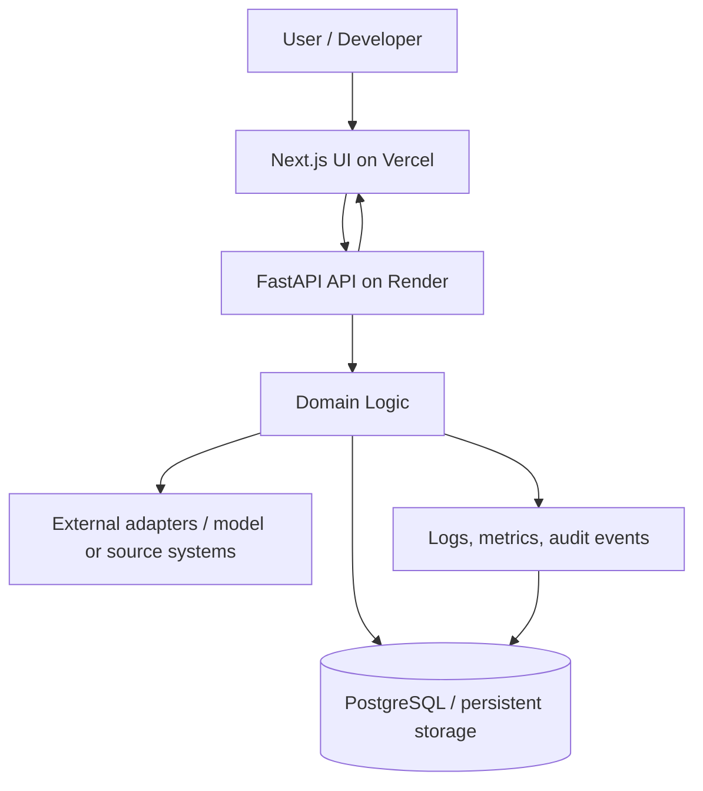
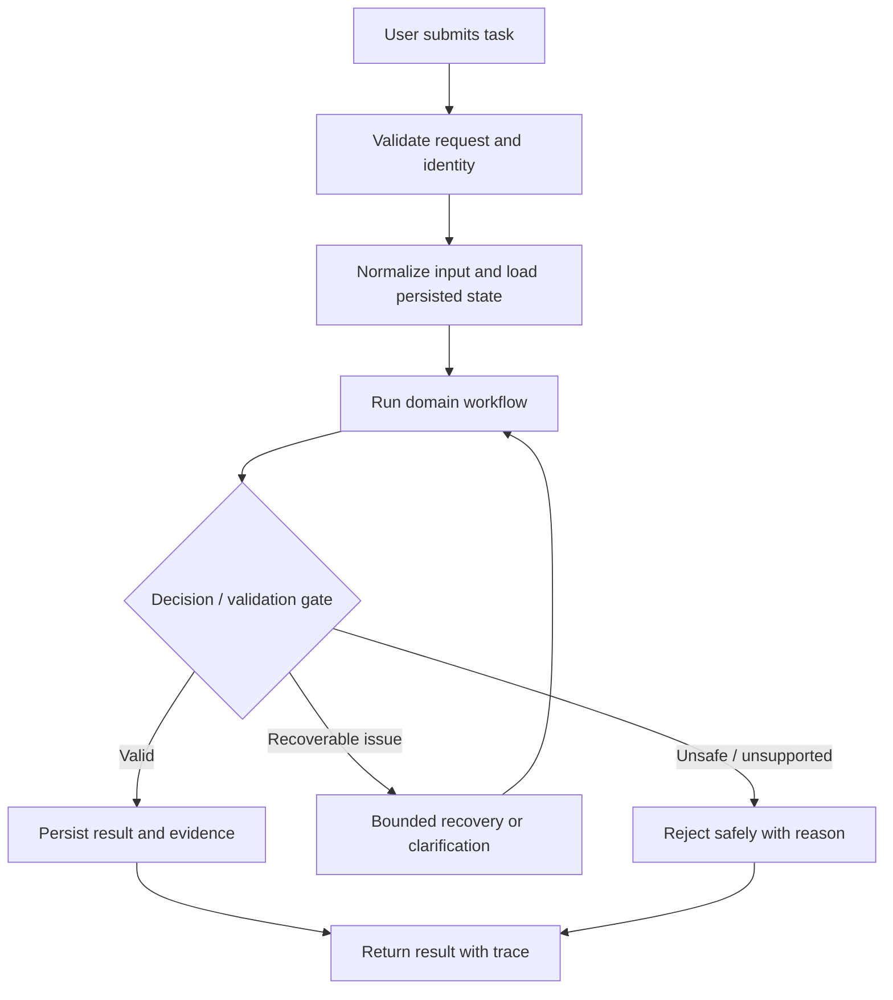
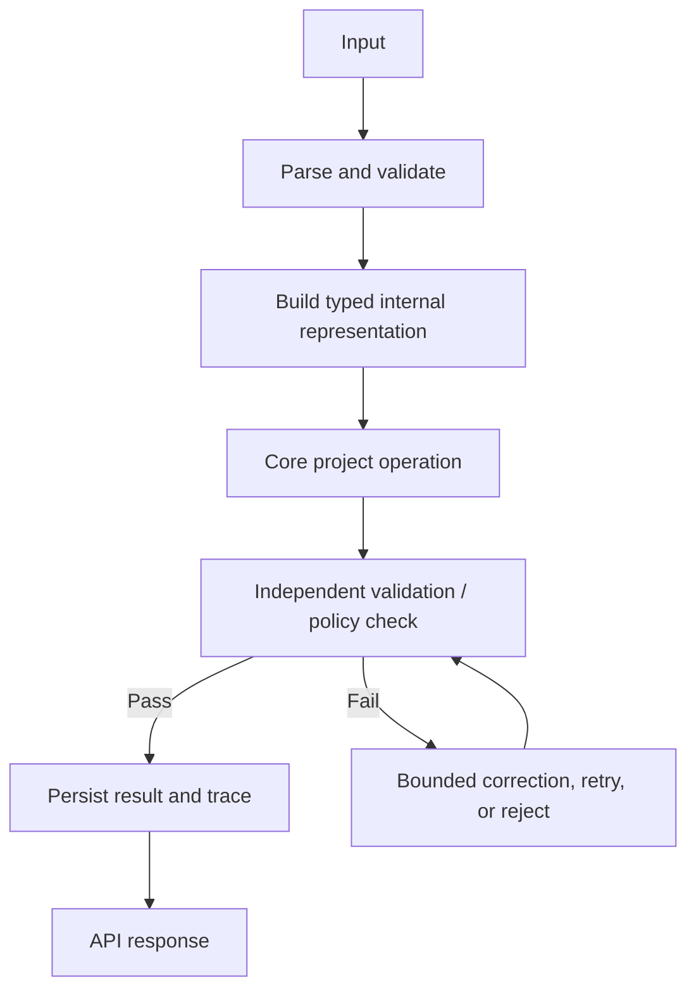
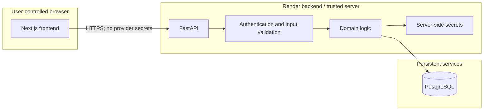
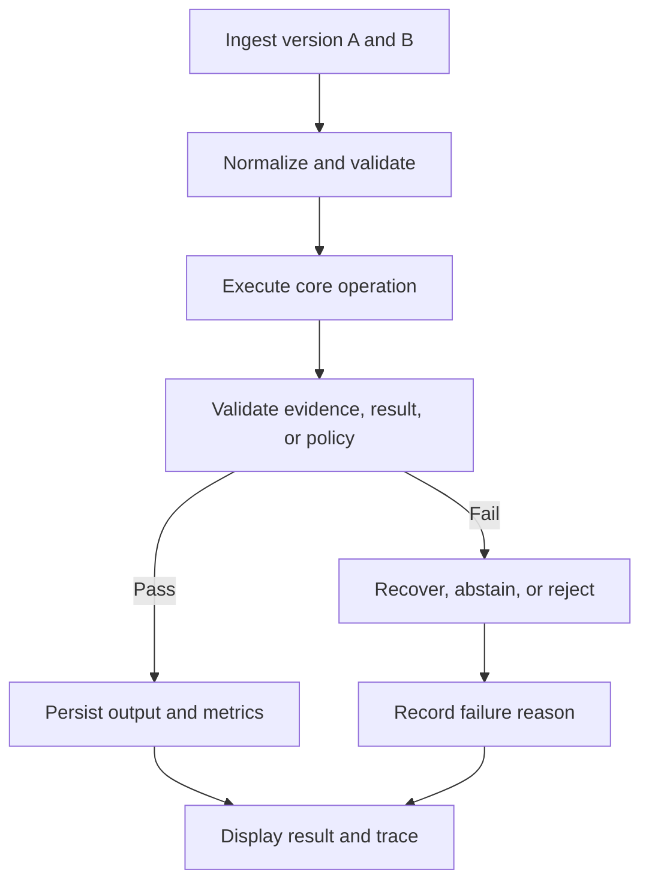

# Design Graph — Version-aware technical documentation retrieval and change-impact analysis

> These graphs describe the intended MVP architecture. Keep them synchronized with the implementation. Mark unimplemented nodes as planned in `State.md`; do not present planned architecture as shipped.

## 1. System context

## 2. High-level request flow

## 3. Detailed project workflow

## 4. Deployment and trust boundaries

## 5. Project-specific workflow

## Graph maintenance rules

- Update the graph when a component, data contract, trust boundary, state transition, persistence dependency, or external integration changes.
- Add nodes and edges only when grounded in actual code or explicitly labeled as planned.
- Keep diagrams readable; split a graph if it becomes too dense.
- Explain non-obvious edges and failure paths in `Explain.md`.
