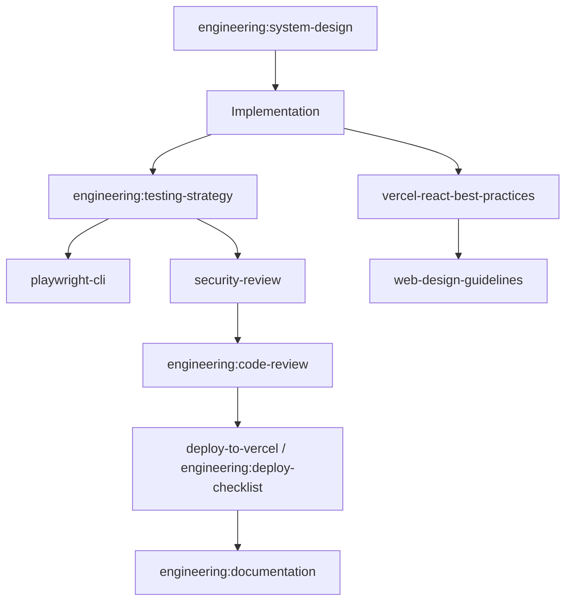

# State — SpecTrace

## Project identity
- **Name:** SpecTrace
- **Purpose:** Version-aware technical documentation retrieval and change-impact analysis.
- **Status:** `PLANNING / NOT IMPLEMENTED`
- **Last updated:** 2026-10-16
- **Source of truth:** Actual repository contents and verified execution results. This file is project memory, not a substitute for code.

## Current objective
When technical specifications, OpenAPI schemas, and documentation change, engineers need to identify what changed and which downstream components, examples, integrations, and requirements may be affected. Ordinary RAG retrieves relevant text but often cannot trace versioned dependencies.

## Scope for the first MVP
- [ ] Accept Git repository URLs or uploaded Markdown, OpenAPI YAML/JSON, and text-based technical documents from two versions.
- [ ] Normalize sources into versioned artifacts with stable identifiers and source locations.
- [ ] Detect additions, deletions, and semantic changes; preserve exact source diffs.
- [ ] Extract entities such as endpoints, schemas, requirements, examples, and named components.
- [ ] Build a lightweight dependency graph from explicit references and cautiously inferred links.
- [ ] Answer impact questions with evidence paths and clear labels for confirmed versus inferred impacts.
- [ ] Provide an interface to inspect a change, graph path, source snippets, and confidence.

## Current architecture hypothesis
Next.js frontend on Vercel; FastAPI API on Render; PostgreSQL for metadata and graph edges; pgvector optional for semantic retrieval; background ingestion task; GitHub API or uploaded archives as sources. Use deterministic parsers for OpenAPI and Markdown first; use an LLM only for semantic change classification and ambiguous links.

## Current status and milestones
- [x] Project concept selected.
- [x] Starter documentation scaffold generated.
- [ ] Repository initialized.
- [ ] Architecture and dependencies verified.
- [ ] First end-to-end vertical slice implemented.
- [ ] Component tests run and results recorded.
- [ ] Deployment verified on Vercel and Render.
- [ ] README and demo prepared.

## Verified implementation facts
- No application implementation has been created by this starter pack.
- No tests have been run.
- No deployment has been performed.
- Do not change these statements until verified evidence exists.

## Current blockers / unknowns
- [ ] Choose model/provider and confirm pricing/limits if an external model is needed.
- [ ] Confirm deployment environment variables and persistent storage configuration.
- [ ] Confirm data licensing and benchmark provenance.
- [ ] Decide authentication needs based on public-demo scope.

## Starting repository state (verified 2026-10-16)
- `SpecTrace/` contains only `DOCS/`. No git repository, no `backend/`, `frontend/`, `scripts/`, lockfiles, or `.env.example`.
- `DOCS/ProjectBreif.md` created as a byte-identical copy of `DOCS/Prompt.md` (per `CLAUDE.md`). `Prompt.md` retained.
- `Testing.md` read only; not modified.
- Local tools (checked via `--version`): Node v24.13.0, npm 11.6.2, git 2.52.0, Docker 29.0.1. **Not found:** pnpm, psql.
- **Correction (2026-10-16):** the earlier "Python 3.14.2 in conda env" reading was wrong. The `SpecTrace` env had no interpreter, and `conda run` fell through PATH to `C:\Python314`. Python 3.13.16 is now installed in the env (`D:\Anaconda3\envs\SpecTrace\python.exe`). Installed with `pip check` clean: fastapi 0.143.2, uvicorn 0.54.0, python-multipart 0.0.32, psycopg[binary] 3.3.6, pydantic 2.14.1, pydantic-settings 2.16.0, ruamel.yaml 0.19.1, SQLAlchemy 2.1.4, alembic 1.20.0, httpx 0.28.1, pytest 9.1.1, pytest-cov 7.1.0, ruff 0.17.1.
- Supabase MCP and Render MCP: connected per user (2026-10-16); not yet used or verified from this session.
- Brief defect: the "Security and safety" section of `Prompt.md`/`ProjectBreif.md` contains an unrendered template placeholder (`{p['risks']}`). Security requirements are currently taken from `CLAUDE.md` constraints and `Decision.md` D-004. Not edited; needs user input.
- Python version resolved: 3.13.16 chosen for full `cp313` wheel coverage and Render support.

## Skill discovery and skill graph (agent: Claude Code, VS Code extension; discovered 2026-10-16)
Sources checked: skills exposed in the agent session; `C:\Users\rajvaedhan singh\.claude\skills` (directory listing, names only). Project-level `.claude\skills` and `.agents\skills` do not exist. `npx skills list` was not run. Skill instructions have **not** been read yet, so none is `loaded` or `applied`.

| Skill | Source | Purpose for SpecTrace | Status |
|---|---|---|---|
| `engineering:system-design` | plugin (session) | Service boundaries, data model, API design | selected |
| `engineering:architecture` | plugin (session) | Recording architecture decisions | available |
| `engineering:testing-strategy` | plugin (session) | Test design that satisfies `Testing.md` | selected |
| `engineering:code-review` | plugin (session) | Review of final changes | available |
| `security-review` | built-in (session) | Review of pending changes before release | selected |
| `vercel-react-best-practices` | session + `.claude\skills` | Next.js frontend | selected |
| `web-design-guidelines` | session + `.claude\skills` | Accessibility / UI review | available |
| `deploy-to-vercel` | session + `.claude\skills` | Frontend deployment (needs authorization) | available |
| `playwright-cli` | session + `.claude\skills` | End-to-end UI tests | available |
| `engineering:deploy-checklist` | plugin (session) | Render/Vercel release checks | available |
| `engineering:documentation` | plugin (session) | README and docs | available |

No Python/FastAPI-specific or Render-specific skill was found; those are covered by general engineering skills and project docs. GSD workflow skills (`gsd-*`) exist but are not used, to avoid imposing a second planning process on top of the `DOCS/` protocol.

### Skill graph refresh policy
- Reassess after every three non-trivial updates to this file, or before a major change.
- Reuse verified discovery results while the agent and environment remain unchanged.
- Never report a skill as loaded or applied unless that happened.

## Recent activity log
- 2026-10-16 — Created starter documentation pack; application code, tests, and deployment are not included.
- 2026-10-16 — Read all `DOCS/` files. Created `DOCS/ProjectBreif.md` (copy of `Prompt.md`). Inspected repository (docs only) and local tooling. Ran first-run skill discovery; skill graph recorded above. No code written, no tests run.

- 2026-10-16 — Filled the "Security and safety" section of `Prompt.md`/`ProjectBreif.md` (kept identical). Confirmed conda env `SpecTrace` runs Python 3.14.2 with pydantic 2.10.3, SQLAlchemy 2.0.39, Alembic 1.18.4, pytest 8.3.4, PyYAML, ruamel.yaml; FastAPI, uvicorn and a Postgres driver are **not installed**. No Supabase tool is available in this session; the user creates the project. Superpowers 6.3.0 skills found at `~\.claude\plugins\cache\claude-plugins-official\superpowers\6.3.0\skills`; read `using-superpowers`, `brainstorming`, `writing-plans` (loaded, applied to produce the spec and plan). Wrote design spec and Plan 1 under `DOCS/superpowers/`. Awaiting user approval; no code written.
- 2026-10-16 — Installed Python 3.13.16 and all dependencies into the env. Reviewed Plan 1 and fixed 10 flaws (review log at the end of the plan). Verified the YAML alias-bomb cap and ruamel line info with a throwaway probe script outside the repo. No project code written yet; `git init` still awaiting authorization.

## Next recommended action
Resolve the blockers above that affect the first slice (Python version for the backend, database for local development, whether an LLM is used in the MVP), record them in `Decision.md`, then build the backend vertical slice on sample two-version data: parse OpenAPI and Markdown, diff, extract entities, build the graph, return an impact report with confirmed/inferred labels.
