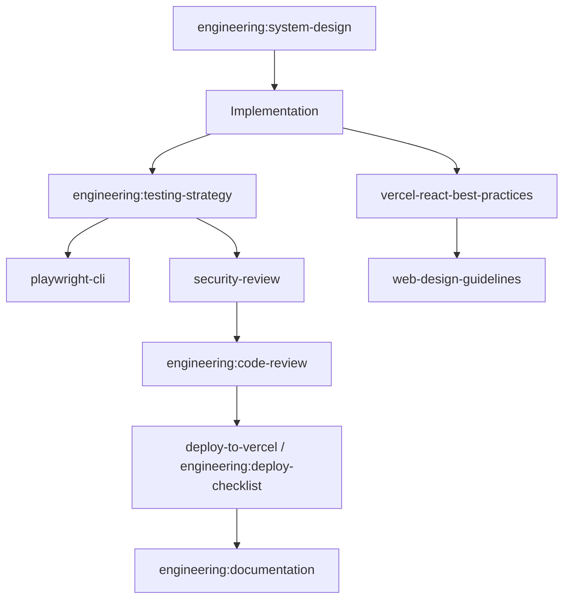

# State — SpecTrace

## Project identity
- **Name:** SpecTrace
- **Purpose:** Version-aware technical documentation retrieval and change-impact analysis.
- **Status:** `IN DEVELOPMENT — core engine (Plan 1) and run persistence + /v1 API (Plan 2, local) implemented and tested; Supabase schema applied; benchmark v1 (Plan 3) and frontend (Plan 4) implemented and tested locally; GitHub source and deployment not done`
- **Last updated:** 2026-10-16
- **Source of truth:** Actual repository contents and verified execution results. This file is project memory, not a substitute for code.

## Current objective
When technical specifications, OpenAPI schemas, and documentation change, engineers need to identify what changed and which downstream components, examples, integrations, and requirements may be affected. Ordinary RAG retrieves relevant text but often cannot trace versioned dependencies.

## Scope for the first MVP
- [ ] Accept Git repository URLs or uploaded Markdown, OpenAPI YAML/JSON, and text-based technical documents from two versions. *(engine takes in-memory `{path: text}` dicts for both versions — implemented and tested; upload/GitHub intake and HTTP route: planned, Plans 2 and 5)*
- [x] Normalize sources into versioned artifacts with stable identifiers and source locations. *(implemented, unit-tested)*
- [x] Detect additions, deletions, and semantic changes; preserve exact source diffs. *(deterministic classification only; no LLM; implemented, unit-tested)*
- [x] Extract entities such as endpoints, schemas, requirements, examples, and named components. *(endpoints, schemas, sections, requirements, examples; "named components" not implemented)*
- [x] Build a lightweight dependency graph from explicit references and cautiously inferred links. *(implemented, unit-tested)*
- [x] Answer impact questions with evidence paths and clear labels for confirmed versus inferred impacts. *(engine level; no HTTP route yet)*
- [x] Provide an interface to inspect a change, graph path, source snippets, and confidence. *(implemented in `frontend/`, tested locally with Chrome; not deployed)*

## Current architecture hypothesis
Next.js frontend on Vercel; FastAPI API on Render; PostgreSQL for metadata and graph edges; pgvector optional for semantic retrieval; background ingestion task; GitHub API or uploaded archives as sources. Use deterministic parsers for OpenAPI and Markdown first; use an LLM only for semantic change classification and ambiguous links.

## Current status and milestones
- [x] Project concept selected.
- [x] Starter documentation scaffold generated.
- [x] Repository initialized (git, branch `main`, 2026-10-16).
- [x] Architecture and dependencies verified (Python 3.13.16 env, `pip check` clean).
- [ ] First end-to-end vertical slice implemented. *(engine slice done at the library level only; user-visible slice needs Plans 2 and 4)*
- [x] Component tests run and results recorded (see "Test results" below).
- [ ] Deployment verified on Vercel and Render.
- [ ] README and demo prepared.

## Verified implementation facts
- Implemented and verified (2026-10-16): `backend/app/core/` (models, limits, OpenAPI parser, Markdown parser, graph, diff, impact, pipeline) and the `backend/app` shell (`/health`, error envelope, CORS allow-list).
- Also implemented and verified (2026-10-16, Plan 2): `app/adapters/store.py` (SQLAlchemy `RunStore`, `runs` table), `app/api/v1/runs.py` (`POST/GET /v1/runs`, `GET /v1/runs/{id}`, `POST /v1/runs/{id}/ask`), request-size middleware, fixed-message validation errors, `supabase/` CLI layout.
- Not implemented: Alembic (the schema is a Supabase SQL migration instead), normalized artifact/edge/change tables (a run stores inputs and result as JSON), upload/GitHub sources, rate limiting, logging, LLM adapter, benchmark, frontend, deployment config, README, `.env.example`.
- No deployment has been performed. Supabase project `SpecTrace` (`kwrfzsktlahleiytxnnm`, ap-northeast-1) has migration `20261015221156_create_runs` applied. Render MCP is connected but unused. The backend has NOT been run against the hosted Supabase database (no pooler URL configured).

## Test results (recorded 2026-10-16)
- Command: `conda run -n SpecTrace --cwd backend python -m pytest --cov=app -q` → **65 passed, 1 warning** (starlette `httpx` deprecation notice), 0 failed, 0 skipped.
- Coverage: **92%** overall (716 statements, 56 missed). Lowest: `diff.py` 80% (several classification rules untested: parameter type change, request-body rules, response removal/schema change, schema type change), `graph.py` 86% (duplicate-entity and unknown-endpoint/requirement warning branches), `markdown.py` 92%, `impact.py` 92% (expansion cap untested).
- Lint: `ruff check` clean, `ruff format --check` clean.
- Domain purity: no `fastapi`/`sqlalchemy`/`psycopg`/`app.api`/`app.adapters` imports under `backend/app/core` (grep).
- `Testing.md` scenarios 1–4 have regression tests (`tests/test_regression_scenarios.py`); scenario 5 (private repo) is not applicable until the GitHub adapter exists. Integration, E2E, security (beyond parser bounds), reliability and benchmark tests: **not yet written**.
- Tests were written together with implementation for Tasks 4, 6, 7, 8 rather than seen failing first; Tasks 1, 2, 3, 5 were run red first. Treat the tests as unproven against mutation until the missing diff rules above are covered.

## Current blockers / unknowns
- [ ] Choose model/provider and confirm pricing/limits if an external model is needed.
- [ ] Confirm deployment environment variables and persistent storage configuration.
- [ ] Confirm data licensing and benchmark provenance.
- [ ] Decide authentication needs based on public-demo scope.

## Starting repository state (verified 2026-10-16)
- `SpecTrace/` contains only `DOCS/`. No git repository, no `backend/`, `frontend/`, `scripts/`, lockfiles, or `.env.example`.
- `DOCS/ProjectBreif.md` created as a byte-identical copy of `DOCS/Prompt.md` (per `CLAUDE.md`). `Prompt.md` retained.
- `Testing.md` read only; not modified.
- Local tools (checked via `--version`): Node v24.13.0, npm 11.6.2, git 2.52.0, Docker 29.0.1. **Not found:** pnpm, psql.
- **Correction (2026-10-16):** the earlier "Python 3.14.2 in conda env" reading was wrong. The `SpecTrace` env had no interpreter, and `conda run` fell through PATH to `C:\Python314`. Python 3.13.16 is now installed in the env (`D:\Anaconda3\envs\SpecTrace\python.exe`). Installed with `pip check` clean: fastapi 0.143.2, uvicorn 0.54.0, python-multipart 0.0.32, psycopg[binary] 3.3.6, pydantic 2.14.1, pydantic-settings 2.16.0, ruamel.yaml 0.19.1, SQLAlchemy 2.1.4, alembic 1.20.0, httpx 0.28.1, pytest 9.1.1, pytest-cov 7.1.0, ruff 0.17.1.
- Supabase MCP and Render MCP: connected per user (2026-10-16); not yet used or verified from this session.
- Brief defect: the "Security and safety" section of `Prompt.md`/`ProjectBreif.md` contains an unrendered template placeholder (`{p['risks']}`). Security requirements are currently taken from `CLAUDE.md` constraints and `Decision.md` D-004. Not edited; needs user input.
- Python version resolved: 3.13.16 chosen for full `cp313` wheel coverage and Render support.

## Skill discovery and skill graph (agent: Claude Code, VS Code extension; discovered 2026-10-16)
Sources checked: skills exposed in the agent session; `C:\Users\rajvaedhan singh\.claude\skills` (directory listing, names only). Project-level `.claude\skills` and `.agents\skills` do not exist. `npx skills list` was not run. Skill instructions have **not** been read yet, so none is `loaded` or `applied`.

| Skill | Source | Purpose for SpecTrace | Status |
|---|---|---|---|
| `engineering:system-design` | plugin (session) | Service boundaries, data model, API design | selected |
| `engineering:architecture` | plugin (session) | Recording architecture decisions | available |
| `engineering:testing-strategy` | plugin (session) | Test design that satisfies `Testing.md` | selected |
| `engineering:code-review` | plugin (session) | Review of final changes | available |
| `security-review` | built-in (session) | Review of pending changes before release | selected |
| `vercel-react-best-practices` | session + `.claude\skills` | Next.js frontend | selected |
| `web-design-guidelines` | session + `.claude\skills` | Accessibility / UI review | available |
| `deploy-to-vercel` | session + `.claude\skills` | Frontend deployment (needs authorization) | available |
| `playwright-cli` | session + `.claude\skills` | End-to-end UI tests | available |
| `engineering:deploy-checklist` | plugin (session) | Render/Vercel release checks | available |
| `engineering:documentation` | plugin (session) | README and docs | available |

No Python/FastAPI-specific or Render-specific skill was found; those are covered by general engineering skills and project docs. GSD workflow skills (`gsd-*`) exist but are not used, to avoid imposing a second planning process on top of the `DOCS/` protocol.

### Skill graph refresh policy
- Reassess after every three non-trivial updates to this file, or before a major change.
- Reuse verified discovery results while the agent and environment remain unchanged.
- Never report a skill as loaded or applied unless that happened.

## Recent activity log
- 2026-10-16 — Created starter documentation pack; application code, tests, and deployment are not included.
- 2026-10-16 — Read all `DOCS/` files. Created `DOCS/ProjectBreif.md` (copy of `Prompt.md`). Inspected repository (docs only) and local tooling. Ran first-run skill discovery; skill graph recorded above. No code written, no tests run.

- 2026-10-16 — Filled the "Security and safety" section of `Prompt.md`/`ProjectBreif.md` (kept identical). Confirmed conda env `SpecTrace` runs Python 3.14.2 with pydantic 2.10.3, SQLAlchemy 2.0.39, Alembic 1.18.4, pytest 8.3.4, PyYAML, ruamel.yaml; FastAPI, uvicorn and a Postgres driver are **not installed**. No Supabase tool is available in this session; the user creates the project. Superpowers 6.3.0 skills found at `~\.claude\plugins\cache\claude-plugins-official\superpowers\6.3.0\skills`; read `using-superpowers`, `brainstorming`, `writing-plans` (loaded, applied to produce the spec and plan). Wrote design spec and Plan 1 under `DOCS/superpowers/`. Awaiting user approval; no code written.
- 2026-10-16 — Installed Python 3.13.16 and all dependencies into the env. Reviewed Plan 1 and fixed 10 flaws (review log at the end of the plan). Verified the YAML alias-bomb cap and ruamel line info with a throwaway probe script outside the repo. No project code written yet; `git init` still awaiting authorization.

- 2026-10-16 — Executed Plan 1 inline (no subagents), commit per task: scaffold, models, OpenAPI parser, Markdown parser, graph, diff, impact, pipeline. 65 tests pass, 92% coverage. Deviations from the plan: `pytest` `pythonpath` includes `tests` so `import helpers` works; ruff reformatted imports/long lines. Skills actually applied: `superpowers:writing-plans` (plan authoring), `superpowers:brainstorming` (design gate). `test-driven-development`, `verification-before-completion` and `executing-plans` were not opened; their practices were followed informally, not by reading the skills, so they are **not** reported as applied.

## Next recommended action
1. Close the diff-rule coverage gaps listed under "Test results" (small, same plan).
2. Write Plan 2 (persistence + `/v1` API + security tests): create the Supabase project through the MCP (needs user go-ahead for the region and any cost), start Docker Postgres for integration tests, add SQLAlchemy models, Alembic migrations with RLS, run lifecycle and routes.
3. Then Plans 3 (benchmark), 4 (frontend), 5 (GitHub source, deployment, README).

## Test results, Plan 2 (recorded 2026-10-16)
- `python -m pytest -q` (SQLite, default): **86 passed, 2 skipped** (the two Postgres integration tests need `SPECTRACE_TEST_DATABASE_URL`).
- `SPECTRACE_TEST_DATABASE_URL=postgresql+psycopg://...@127.0.0.1:54322/postgres python -m pytest --cov=app -q` (Supabase CLI local Postgres 17): **88 passed**, coverage **96%** (844 statements, 36 missed). `diff.py` 100%.
- `supabase test db` (pgTAP, `supabase/tests/runs.test.sql`): **8/8 passed** against the local database. Covers table exists, RLS on, valid insert, status and label-length checks, `anon` read denied, `authenticated` write denied.
- The first Postgres run failed (`column "id" is of type uuid but expression is of type character varying`); fixed by using `Uuid` and `JSONB` variants. Invalid run ids return 404 instead of a database error.
- Lint: `ruff check` and `ruff format --check` clean.
- Hosted-database behavioural test (insert/deny against the live project) was declined three times at the tool-permission prompt and was not run; the same checks pass locally. Hosted state was verified read-only (`list_tables`: RLS on, constraints present; security advisor: only the expected INFO `rls_enabled_no_policy`).
- Not yet written: API security tests beyond size/validation (rate limits, log redaction), reliability tests, E2E, benchmark.

## Recent activity log, Plan 2
- 2026-10-16 — Closed diff-rule coverage gaps (14 tests). Added the Supabase CLI (scoop, v2.121.0; local stack via Docker). Built the run store and `/v1` routes, applied the `runs` migration to Supabase, moved SQL to `supabase/migrations/` with the remote version timestamp, added a pgTAP test and Postgres integration tests. Skills actually applied: none loaded this session.

## Next recommended action (updated)
1. Configure `SPECTRACE_DATABASE_URL` with the Supabase session-pooler URL (user to supply/approve; never commit) and run the integration tests against the hosted project.
2. Rate limiting and safe logging (Testing.md security layer), then Plan 3 (benchmark), Plan 4 (frontend), Plan 5 (GitHub source, deployment, README).

## Test results, rate limiting and logging (recorded 2026-10-16)
- Default run (SQLite): **102 passed, 2 skipped**. Run with `SPECTRACE_TEST_DATABASE_URL` set to the hosted Supabase session-pooler URL: **104 passed**, coverage **96%** (960 statements, 40 missed), 0 failed. The Postgres tests delete the rows they create; the hosted `runs` table had 0 rows afterwards (checked with `list_tables`). Two leftover rows from the earlier run were verified as test data (sample petstore files, `../x.md`) and deleted.
- Hosted database connection works only through the **session pooler** (IPv4). The direct host `db.<ref>.supabase.co` has an AAAA record only and this machine has no IPv6, so it does not resolve here. A plain `postgresql://` URL is converted to `postgresql+psycopg://` by `Settings`.
- Rate limiting (`app/api/ratelimit.py`): sliding window per client IP, 120/min general and 10/min for POST by default; `/health` and CORS preflight exempt; 429 with `rate_limited` envelope and `Retry-After`; tracked keys capped at 10,000. `X-Forwarded-For` is ignored unless `SPECTRACE_TRUST_PROXY_HEADERS=true`. Limits are per process and reset on restart; they are not shared across workers.
- Safe logging (`app/logging_config.py`, middleware in `main.py`): one line per request with request id, method, route template (not the raw URL), status and duration; `X-Request-ID` response header; rejected requests log the error code only; unhandled errors log the exception class only and return a generic 500. A filter redacts URL credentials and `password/token/secret/api key/authorization` pairs and strips control characters. Tests assert that submitted file names, bodies, path text and error messages never appear in logs.
- Known gaps: the body-size check relies on `Content-Length`, so a chunked upload without it is not rejected early (the file and total size limits still apply after parsing); no authentication; rate limits are in-memory.

## Benchmark v1 (recorded 2026-10-16, Plan 3)
- Command: `conda run -n SpecTrace python -m scripts.benchmark --save` from `backend/`. Dataset `benchmark/v1/` (14 synthetic cases, 26 labeled impacts; split dev 16 impacts, heldout 10). Saved result: `benchmark/v1/results/*-all.json`, which records dataset version, engine configuration, commit and date. Metric definitions: `benchmark/v1/README.md`.
- Engine: impact precision **1.00**, recall **0.96** (dev 1.00/0.94, heldout 1.00/1.00). Baseline (keyword retrieval): precision **0.87**, recall **0.77** (dev 0.85/0.69, heldout 0.90/0.90).
- Certainty accuracy 1.00, citation accuracy 1.00, false-confirmed 0, change detection precision/recall 1.00, classification accuracy 1.00, unsupported-impact rate 0 (0 of 25 reported), median 2.67 ms per document.
- The one engine miss: c04, a documentation section four hops from the change (the search stops at three hops). Labeled as impacted before the run and left as is.
- The engine was not tuned. The baseline pattern was corrected once after the first run because it refused a name preceded by `/` (so `schemas/Pet` did not count as a mention); this is disclosed in the benchmark README.
- Caveats: the labels were written by the assistant that built the engine, before the first run, and have not been reviewed by a person. The dataset is small and synthetic. Held-out recall moves 10 points per error. These numbers are a development measurement, not an independent evaluation.
- Tests: `tests/test_benchmark.py` (12) checks dataset consistency (quoted text at each labeled line), zero unsupported impacts, zero false-confirmed, reproducibility, evidence validity checks and metric arithmetic. Full suite: **114 passed, 2 skipped** (SQLite default), lint clean, coverage 96% over `app` and `scripts`.
- Not done: the `benchmark_runs` table from the spec (results are stored as files under `benchmark/v1/results/`), an embedding-retrieval baseline, labels reviewed by a person.

## Frontend (recorded 2026-10-16, Plan 4)
- `frontend/`: Next.js 16.4.2 (App Router), React 19.3.1, TypeScript, plain CSS from tokens (no Tailwind or component library). Routes: `/` compare and history, `/runs/[id]` change ledger with evidence paths, cited source lines and source diff, question box; `/benchmark` stored benchmark result with its caveats. Run instructions: `frontend/README.md`. Design direction: `frontend/DESIGN.md`, **agent-authored and not approved by the product owner** (no brand direction existed); dials ENERGY 1 / RHYTHM 2 / MOTION 1.
- Backend addition for it: `GET /v1/runs/{id}/snippet` (cited source lines, dictionary lookup on stored files, 404 for unknown files or lines, 422 for bad parameters). Backend suite: **118 passed, 2 skipped**, coverage 96% over `app` and `scripts`.
- Checks run (2026-10-16): `tsc --noEmit` clean; `eslint` clean; Vitest **49 passed** (unit and component: files, diff, evidence, formatting, API client including timeout and Retry-After, every component state); Playwright in system Chrome against the real backend (in-memory database) and a production build: **19 passed**. They cover the main flow, own-file upload with skipped-file notices, invalid YAML, backend down, rate limit, unknown run, 404 page, empty result, benchmark page, keyboard-only flow, axe (WCAG 2 A/AA, 2.1, 2.2 AA and best-practice) on every screen in light and dark, no horizontal overflow and 44 px targets at 375 px, usable at 320 px, and no database URL or secret in any response served to the browser. The hosted `runs` table still had 0 rows afterwards.
- Defects found by these tests and fixed: the skipped-file notice for version A was erased when files were chosen for B; 1 px horizontal overflow of the header at 320 px; "Show source at" lost the space before the file name; repeated "Confirmed" boxes on every hop; the question box pushed the change list out of view; the backend did not expose `Retry-After` and `X-Request-ID` to browsers (now tested).
- CORRECTION (2026-10-16, later): the intermittent browser failure noted here was **not** a timing sensitivity. It was a backend race in the in-memory SQLite mode: all requests shared one connection, so a `GET /v1/runs` could end the transaction of a concurrent `POST /v1/runs`, and the next step then crashed with an `AttributeError` (HTTP 500). It was found by counting server 500s across repeated full runs (2 of 4 runs had exactly one), reproduced with `tests/test_store_concurrency.py` (failed 3 of 3 times), and fixed with a lock in `RunStore` for SQLite only. Afterwards 5 consecutive full browser runs passed with 0 server errors. Postgres, which has a real connection pool, is unaffected. The assertion timeout raise from 5 s to 10 s stays but was not the fix.
- Contrast: every text pair in `DESIGN.md` was computed with the antislop checker (light and dark); control borders are at least 3:1.
- Skills actually loaded and followed: `anti-ai-slop-ui`, `antislop` (core), `antislop-ui`, `antislop-copywriting`, `antislop-human`, `antislop-layoutmobile`. Scripts actually run: `contrast-check.py`, `ui_lint.py` (reported 0.0 of 10; it is a heuristic and only reads what it can match). The AI Slop and Distinctiveness scores are the assistant's own judgment, not an independent review. Mode: "during" (the user asked for the skills while developing).
- Not done at that point (since done: theme toggle, drag and drop, automated accessibility checks; see the next section): deployment, a visual review by a person, a pass with a real screen reader, GitHub source.

## Next recommended action (updated after Plan 4)
1. Review `frontend/DESIGN.md` and the screens and say what to change; the direction was chosen by the assistant.
2. Review the benchmark labels (`benchmark/v1/cases/*/expected.json`); they are unreviewed.
3. Deployment (Plan 5): Render for the backend with the session-pooler URL as a secret and `SPECTRACE_TRUST_PROXY_HEADERS=true`, Vercel for the frontend with `NEXT_PUBLIC_API_URL`, then set `SPECTRACE_CORS_ORIGINS` to the Vercel origin. Each needs your authorization.

## Frontend round 2 (recorded 2026-10-16)
- Added: drag and drop of files and folders onto each version box (folders read recursively in batches, `node_modules` and `.git` skipped, 1,000-file cap, drop outside a box ignored so the browser does not leave the page, spoken status line); a three-way theme toggle (System, Light, Dark) with the choice stored in `localStorage` and applied before first paint; accessibility fixes (source panel live region always present, page title names the versions, forced-colors rules, status lines for adding and removing files).
- Tests now: backend **119 passed, 2 skipped** (new: store concurrency); frontend unit and component **65 passed**; Chrome end-to-end **51 passed** on five consecutive full runs with 0 server errors. New browser coverage: drag and drop, theme (system, manual, persistence before paint, blocked storage, 320 px header), landmarks and headings, titles, live regions, tab order and focus indicators, no keyboard trap, forced colors, reduced motion, WCAG 1.4.12 text spacing, text enlarged to 200% and 300%, axe with a manual theme that differs from the system theme.
- Visually checked in screenshots: drag state over the manual dark theme, forced-colors mode, the 320 px header.
- **Still not done: a pass with a real screen reader and testing with people.** `frontend/ACCESSIBILITY.md` lists what is verified, what is not, and a manual checklist.

## RAG layer (recorded 2026-10-17)
- Why: the project was meant to be a RAG use case (an LLM that compares versions, summarizes both, says what changed, answers questions). Plans 1 to 4 built only the deterministic half; the brief made the LLM and pgvector optional, and the spec's P1 (no LLM in the MVP) was recorded as accepted without an explicit decision. On 2026-10-17 the user clarified the intent and chose OpenRouter or Groq for chat, a free or Hugging Face style embedding source (suggestions were requested), documents may be sent to providers, and per-comparison knowledge base first, project library after.
- Built: provider adapters for any OpenAI-compatible chat and embeddings API (OpenRouter, Groq, Jina or generic base URL) with bounded retries and safe errors; a local hashing embedder and an optional fastembed one; a deterministic test model; structure-aware chunking; hybrid retrieval (BM25 plus vector similarity, reciprocal rank fusion); context assembly that puts graph facts first; prompts with random-token delimiters and neutralized document text; strict checks on model output (JSON only, citations must exist, uncited or entity-inventing replies withheld); summaries of both versions and of the changes; storage of chunks and embeddings in Supabase pgvector with a model-aware cache; per-owner and per-day call budgets; anonymous per-browser owner tokens so runs are private; UI for summaries (with consent line naming the recipient), questions with expandable sources, and graceful off states; `scripts/check_providers.py`.
- Verified (2026-10-17): backend **219 passed, 8 skipped** (the 8 need a database URL); the 8 Postgres tests (pgvector round trip, DB-side cosine ranking, model filter, cascade delete, full ask and summary flow, owner scoping) **passed on the hosted Supabase project**, which was left with 0 rows; frontend unit **91 passed**; Chrome end-to-end **66 passed** with 0 server errors (API run with the deterministic test model and the hashing embedder); migration `20261017140003_rag_chunks` applied to the hosted project (pgvector 0.8.2); security advisor shows only the intended RLS-without-policy notes.
- NOT verified: any live call to OpenRouter, Groq or an embedding service (no key was available to the assistant; run `python -m scripts.check_providers` after filling `backend/.env`); answer quality with a real model; `supabase test db` for `supabase/tests/chunks.test.sql` (Docker was not running); GitHub Actions workflow; deployment.
- Not built: persistent project library (projects, versions, reuse across comparisons), an HNSW index, an LLM evaluation harness, streaming answers, a re-ranker.
- Tooling note: on this machine free memory is low; Vitest needs the thread pool (configured) and ESLint takes minutes.
