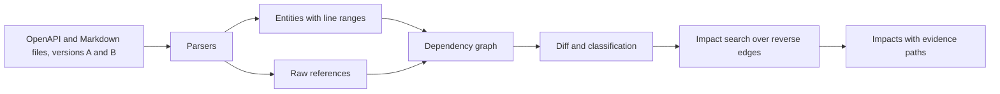
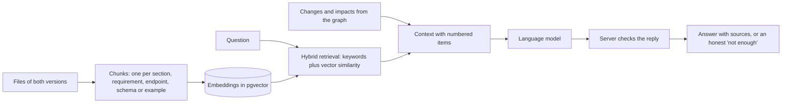

# SpecTrace

**Change-impact analysis for API specifications and their documentation.**

When an API changes, the hard part is not finding the diff. It is finding everything else that quietly stopped being true: the guide section that still describes the old behavior, the requirement that assumed the old type, the example that no longer validates. SpecTrace compares two versions of an OpenAPI file and its Markdown documentation, then shows what changed, what depends on it, and the exact source line that proves each dependency.

An optional language-model layer writes summaries of both versions and answers questions in plain words, always with numbered sources. The facts come from a dependency graph, never from the model.


---

## Contents

- [What you get](#what-you-get)
- [Quick start](#quick-start)
- [Using SpecTrace](#using-spectrace)
- [How the analysis works](#how-the-analysis-works)
- [AI summaries and questions](#ai-summaries-and-questions)
- [Configuration](#configuration)
- [API reference](#api-reference)
- [Deployment](#deployment)
- [Security and privacy](#security-and-privacy)
- [Quality and benchmark](#quality-and-benchmark)
- [Development](#development)
- [Limitations](#limitations)
- [License](#license)

## What you get

- **A precise change list.** Endpoints, parameters, request bodies, responses, schemas, properties and requirements are compared by content, ignoring formatting and comments. Each change is classified as breaking, needs review, non-breaking or documentation only, by fixed rules.
- **Impact with evidence.** For every modified or removed item, SpecTrace searches backwards through the dependency graph and lists the documentation sections, requirements, examples, endpoints and schemas that depend on it. Each result carries the path of links and the source line behind it.
- **Honest certainty.** A link is *confirmed* when the files say so directly (a `$ref`, an endpoint mentioned as `GET /pets`, an anchor link, a requirement ID). A link that is only a reasonable guess is labeled *inferred* and is never presented as a confirmed breaking change.
- **Summaries and answers (optional).** One short summary per version, one of what changed, and a question box. Answers cite numbered sources, and the server rejects any reply that cites something it was not given.
- **Private by default.** There are no accounts. Each browser gets a random token, and a comparison is visible only to the browser that created it.


## Quick start

Requirements: Python 3.13 and Node.js 22.12 or newer. Docker is needed only for a local Supabase stack.

**1. Start the API**

```
cd backend
python -m venv .venv
source .venv/bin/activate          # Windows: .venv\Scripts\activate
pip install -r requirements-dev.txt
cp .env.example .env
uvicorn app.main:app --reload --port 8000
```

Check it at <http://localhost:8000/health>. Interactive API docs are at <http://localhost:8000/docs>.

**2. Start the interface** (second terminal)

```
cd frontend
cp .env.example .env.local
npm install
npm run dev
```

Open <http://localhost:3000>, press **Load petstore example**, then **Compare versions**.

Without `SPECTRACE_DATABASE_URL`, comparisons are kept in memory and disappear when the API restarts. Without a language-model key, everything except summaries and written answers still works.

## Using SpecTrace

1. **Add the two versions.** Drop files onto the version A and version B areas, or pick them with the file chooser. Accepted: OpenAPI 3 in YAML or JSON, and Markdown or plain text documentation.
2. **Compare.** The results page lists every change with its classification, grouped by severity.
3. **Follow an impact.** Open a change to see its dependents. Each one shows its certainty, its link path, and the cited lines from both versions.
4. **Summarize (optional).** Generate a summary of version A, version B and the changes. A notice names the provider before any text is sent.
5. **Ask (optional).** Ask in plain words, for example *"What breaks if Pet changes?"* or *"Which documentation sections now describe the pet identifier incorrectly?"*. The answer lists its sources. When the documents do not contain the answer, SpecTrace says so instead of guessing.

The interface supports light and dark themes, full keyboard use, and enlarged text.

## How the analysis works



1. **Parse.** Endpoints, schemas, Markdown sections, requirements and fenced examples become entities with stable keys such as `endpoint:GET /pets`, `schema:Pet`, `section:docs/guide.md#listing-pets` and `requirement:REQ-001`, each with exact line ranges. YAML is read with a round-trip loader that preserves line numbers and is bounded against alias bombs and deep nesting.
2. **Link.** Each reference becomes an edge, labeled confirmed or inferred.
3. **Diff.** Entities are compared by content hash and classified by deterministic rules.
4. **Trace.** From every modified or removed entity, the engine searches the reverse edges up to three links deep and keeps the best path to each dependent.

### Confirmed and inferred links

| Label | Created by | Confidence |
|---|---|---|
| Confirmed | an OpenAPI `$ref`; a Markdown mention of `METHOD /path` that matches an endpoint; an anchor link to an existing section; an existing requirement ID | 1.0 |
| Inferred | a backticked name that equals a schema name | 0.8 |
| Inferred | a JSON example whose keys overlap a schema's properties (at least 2 shared keys, Jaccard similarity of at least 0.75) | 0.6 |

A dependent is *confirmed* only when every link on its path is confirmed. It is flagged *confirmed breaking* only when, in addition, a fixed rule classifies the change itself as breaking. Changes whose effect cannot be decided by rule, such as a reworded requirement or a removed parameter, are classified **needs review**, never breaking.

### Change classification

| Change | Classification |
|---|---|
| Endpoint or schema removed | breaking |
| Required parameter added; parameter became required; parameter type changed | breaking |
| Request body became required or changed schema; a 2xx response removed or its schema changed | breaking |
| Schema property removed, retyped, or added as required | breaking |
| Parameter or request body removed; non-2xx response removed; requirement added, removed or edited | needs review |
| Optional parameter, response or property added; property no longer required | non-breaking |
| Prose, summaries, examples | documentation only |

## AI summaries and questions

The language model is optional. The dependency graph stays the source of truth; the model explains it and never decides what is confirmed.



**Knowledge base.** Each comparison is its own knowledge base: the two versions you added. Their entities become chunks that follow the structure of the documents, with exact file and line ranges. Chunks and embeddings are stored in Postgres with pgvector the first time a question is asked and reused afterwards.

**Retrieval.** Keyword ranking (BM25) finds exact names and paths. Vector similarity finds passages that say the same thing in other words. Reciprocal rank fusion merges the two. The changes from the graph are always placed in the context, so the model can recognize documentation that describes the old behavior.

**Checks on every reply.** The reply must be one JSON object. Every citation must name an item that was in the context. An answer that cites nothing is not shown, and neither is one that names an endpoint, schema, section, requirement or example that was not in the context. A malformed reply gets one corrective retry. A question that matches nothing in the documents is not sent to the model.

**Prompt injection.** Document text is treated as untrusted data. It is placed between delimiters that carry a random token, angle brackets inside it are neutralized so it cannot close them, and the instructions tell the model to ignore any instructions found in the documents. The model has no tools and cannot fetch anything.

**Cost and abuse guards.** Calls are limited per visitor per hour and per server per day, retries are bounded, prompts are size-bounded, and an embedding outage degrades to keyword retrieval instead of failing the question.

**Privacy.** Nothing is sent to a provider until the visitor clicks, and the interface names the recipient first.

### Choosing providers

Chat and embeddings use the OpenAI-compatible protocol, so a provider is a base URL, a key and a model name. One OpenRouter key covers both chat and embeddings, and free models are available.

| Goal | Settings |
|---|---|
| Chat with OpenRouter | `SPECTRACE_LLM_PROVIDER=openrouter`, `SPECTRACE_LLM_API_KEY`, `SPECTRACE_LLM_MODEL` |
| Chat with Groq | `SPECTRACE_LLM_PROVIDER=groq`, `SPECTRACE_LLM_API_KEY`, `SPECTRACE_LLM_MODEL` |
| Embeddings with OpenRouter | `SPECTRACE_EMBEDDING_PROVIDER=openrouter`, `SPECTRACE_EMBEDDING_MODEL`; reuses the chat key when chat also uses OpenRouter |
| Embeddings with Jina AI | `SPECTRACE_EMBEDDING_PROVIDER=jina`, `SPECTRACE_EMBEDDING_API_KEY`, `SPECTRACE_EMBEDDING_MODEL` |
| Embeddings without a key or network | `SPECTRACE_EMBEDDING_PROVIDER=hashing` (matches shared words, not meaning) or `fastembed` (a local model; `pip install fastembed`; about 1 GB of memory) |
| Any other compatible server | `openai_compatible` with `SPECTRACE_LLM_BASE_URL` or `SPECTRACE_EMBEDDING_BASE_URL` |

`SPECTRACE_LLM_MODEL` accepts a comma-separated list. The first model is used, and the next ones are tried when it is rate limited or returns unusable output. This matters for free models, whose shared capacity is throttled by the provider. Model identifiers and free-tier limits change often, so check the provider's catalog. `backend/.env.example` holds a working starting list.

Verify the setup before using the interface. The check sends a fixed one-word prompt and prints names and timings, never keys or replies:

```
cd backend
python -m scripts.check_providers
```

The stored vectors depend on the embedding model. Changing `SPECTRACE_EMBEDDING_MODEL` makes the next question re-embed the comparison.

## Configuration

Settings are read from environment variables or `backend/.env`. Copy [`backend/.env.example`](backend/.env.example) to `backend/.env`; it runs as it is, and pasting a key on the marked line enables the language-model features.

| Variable | Default | Meaning |
|---|---|---|
| `SPECTRACE_DATABASE_URL` | unset | Postgres URL; unset means in-memory SQLite |
| `SPECTRACE_CORS_ORIGINS` | `["http://localhost:3000"]` | allowed browser origins, as a JSON list |
| `SPECTRACE_MAX_REQUEST_BYTES` | `12000000` | largest request body |
| `SPECTRACE_RATE_LIMIT_PER_MINUTE` | `120` | requests per client per minute |
| `SPECTRACE_RATE_LIMIT_HEAVY_PER_MINUTE` | `10` | POST requests (each runs an analysis) per client per minute |
| `SPECTRACE_TRUST_PROXY_HEADERS` | `false` | read the client address from `X-Forwarded-For`; enable only behind a proxy you control |
| `SPECTRACE_LLM_PROVIDER` | `none` | `none`, `openrouter`, `groq` or `openai_compatible` |
| `SPECTRACE_LLM_API_KEY` | unset | chat provider key |
| `SPECTRACE_LLM_MODEL` | unset | model id, or a comma-separated fallback list |
| `SPECTRACE_LLM_MAX_OUTPUT_TOKENS` | `3000` | reply limit; reasoning models spend part of it on thinking |
| `SPECTRACE_LLM_CALLS_PER_OWNER_PER_HOUR` | `30` | model calls per visitor per hour |
| `SPECTRACE_LLM_CALLS_PER_DAY` | `1000` | model calls per server per day |
| `SPECTRACE_EMBEDDING_PROVIDER` | `none` | `none`, `openrouter`, `jina`, `openai_compatible`, `hashing` or `fastembed` |
| `SPECTRACE_EMBEDDING_API_KEY` | unset | embedding provider key |
| `SPECTRACE_EMBEDDING_MODEL` | unset | embedding model id |

Further timeout, retry, context-size and batch-size settings are listed in [`backend/app/config.py`](backend/app/config.py).

The interface needs one setting, `NEXT_PUBLIC_API_URL`. It is visible in the browser and must never hold a secret.

### Database (optional, for persistence)

Comparisons, chunks and embeddings are stored in two Postgres tables defined in [`supabase/migrations`](supabase/migrations). The second migration enables the `vector` extension. Row level security is enabled with no policies and public roles are revoked, so the tables are reachable only through the API's own connection.

```
supabase start                    # local Postgres (needs Docker)
supabase migration up             # apply migrations
supabase test db                  # SQL tests
supabase link --project-ref <ref> && supabase db push
```

Use the **session pooler** connection string for the API, because the direct host is IPv6 only. A plain `postgresql://` URL is accepted.

## API reference

| Method and path | Purpose |
|---|---|
| `GET /health` | liveness |
| `GET /v1/capabilities` | whether a model and embeddings are configured, their names, and who would receive document text; never a key |
| `POST /v1/runs` | compare two versions; body `{files_a, files_b, label_a, label_b}` where the files are `{path: text}` maps; returns the run summary |
| `GET /v1/runs` | recent comparisons |
| `GET /v1/runs/{id}` | a comparison with its changes, impacts, graph and notes |
| `GET /v1/runs/{id}/snippet?version=a\|b&file=&line=&context=` | source lines around a cited location |
| `POST /v1/runs/{id}/narrative` | `{refresh}`; summaries of both versions and of the changes (needs a model); saved with the run |
| `POST /v1/runs/{id}/ask` | `{question}`; with a model, a written answer with numbered sources plus the graph's dependents; without one, name matching only |

Every `/v1/runs` call needs an `X-Owner-Token` header: a random string of 16 to 128 characters (letters, digits, `-`, `_`) that the client creates and keeps. Only its SHA-256 hash is stored, and a comparison is visible only to its owner; anyone else receives `404`. The web interface creates one token per browser.

Errors always have the shape `{"error": {"code", "message"}}` with a stable code: `input_too_large`, `unsupported_input`, `parse_error`, `limit_exceeded`, `rate_limited`, `invalid_request`, `owner_required`, `not_found`, `llm_unavailable`, `llm_rate_limited`, `llm_timeout`, `llm_bad_output`, `budget_exceeded`, `internal_error`. Messages never echo submitted content.

Limits per version: 200 files, 1 MB per file, 5 MB in total, 200,000 YAML nodes, nesting depth 50, 20,000 entities. Absolute paths and `..` in file names are rejected.

## Deployment

SpecTrace deploys as three parts: a Postgres database, the API, and the interface.

1. **Database (Supabase).** Create a project and apply the migrations with `supabase db push`. Copy the session pooler URL.
2. **API (Render).** Create a Blueprint from [`render.yaml`](render.yaml). Set these in the dashboard:
   - `SPECTRACE_DATABASE_URL`: the pooler URL.
   - `SPECTRACE_CORS_ORIGINS`: a JSON list holding the interface origin, for example `["https://your-app.vercel.app"]`.
   - For the language-model features: `SPECTRACE_LLM_PROVIDER`, `SPECTRACE_LLM_API_KEY`, `SPECTRACE_LLM_MODEL`, `SPECTRACE_EMBEDDING_PROVIDER`, `SPECTRACE_EMBEDDING_API_KEY` and `SPECTRACE_EMBEDDING_MODEL`.

   The health check is `/health`. On Render's free plan the service sleeps when idle, so the first request after a pause is slow.
3. **Interface (Vercel).** Import the repository, set the project root to `frontend`, and set `NEXT_PUBLIC_API_URL` to the API's URL. Then add the Vercel origin to `SPECTRACE_CORS_ORIGINS` on Render and redeploy.

Any host that runs a Python 3.13 web process and a static or Node host for Next.js works the same way.

## Security and privacy

- Uploaded files are untrusted. YAML is parsed with a round-trip loader that constructs no objects and is bounded in nodes and depth. File names are validated.
- Request size is checked before parsing, per-client rate limits apply, and validation errors are replaced by a fixed message so input is not reflected.
- Logs hold identifiers only (request id, route pattern, status, duration, error code), never file names or contents, and a filter redacts credentials in URLs.
- Secrets live in environment variables. The interface contains no database URL or key, and a test verifies that none is served to the browser.
- Provider keys stay on the server. Error messages and logs never include a key, a prompt or a reply.
- The database tables have row level security enabled with no policies.
- There are no accounts. Each browser holds a random owner token, so a public deployment does not expose one visitor's documents to another. Clearing site data forgets the token.

Known gaps: the owner token is possession-based, not an account, so anyone holding it has access and it cannot be recovered. Rate limits and call budgets are per process and in memory. The body-size check relies on `Content-Length`.

## Quality and benchmark

`benchmark/v1` holds 14 synthetic cases with 26 hand-labeled dependents, split into a development set and a held-out set. The comparison is with keyword retrieval: every other entity whose text contains the changed entity's name.

| | Precision | Recall |
|---|---|---|
| SpecTrace | 1.00 | 0.96 |
| Keyword baseline | 0.87 | 0.77 |

Also measured: certainty label correct 1.00, cited line correct 1.00, confirmed claims that the labels contradict 0, impacts without a valid evidence path 0, and a median analysis time of about 2 to 3 ms per document. The single miss is a documentation section four links from the change, beyond the three-link search.

Read these numbers with their limits in mind. The labels were written by the engine's authors before the first run and have not been independently reviewed. The dataset is small and synthetic, and one error moves the held-out recall by 10 points. The engine was not tuned on this data. The keyword baseline was corrected once after the first run; this is disclosed in [`benchmark/v1/README.md`](benchmark/v1/README.md) together with the metric definitions.

The benchmark measures the deterministic engine only. It does not score what a language model writes. The checks on model output are enforced in code and covered by tests, and the full path has been exercised against a live provider on the sample data, but answer quality across real-world documents has not been measured.

```
cd backend
python -m scripts.benchmark                          # all cases
python -m scripts.benchmark --split heldout --details
python -m scripts.benchmark --save                   # writes benchmark/v1/results/<date>-<split>.json
```

## Development

### Repository layout

```
backend/      FastAPI service and the analysis engine
  app/core/       parsers, graph, diff, impact search, chunking, retrieval, model-output checks (no web or database imports)
  app/adapters/   run and chunk store (SQLAlchemy; SQLite in memory or Postgres with pgvector), model and embedding clients
  app/service.py  ties retrieval, the model and the stores together
  app/api/        HTTP routes and the rate limiter
  scripts/        benchmark runner and the provider check
  tests/
frontend/     Next.js interface
benchmark/    dataset v1 and stored results
samples/      petstore example used by the tests and the interface
supabase/     database migrations and SQL tests
render.yaml   Render blueprint for the API
```

### Tests

```
cd backend  && pytest --cov=app --cov=scripts
cd frontend && npm run typecheck && npm run lint && npm test
cd frontend && npm run test:e2e
supabase test db
```

- **Backend:** 252 tests pass and 8 are skipped unless `SPECTRACE_TEST_DATABASE_URL` points to a Postgres database with pgvector.
- **Frontend:** 91 unit and component tests, and 66 end-to-end tests that run in Chrome against a real API.
- **End-to-end setup:** the suite builds the interface and starts both servers, with the API using a deterministic test model and a local hashing embedder so the retrieval and answer path runs without a key. It covers the main flow, bad input, a down or rate-limited API, keyboard use, drag and drop, the theme toggle, axe accessibility scans in light and dark, small screens and enlarged text. By default it expects a conda environment named `SpecTrace` and the system Chrome. Set `E2E_BACKEND_COMMAND` and `E2E_CHANNEL=""` to use a plain Python environment and the Chromium that `npx playwright install chromium` downloads, which is what CI does.
- **SQL:** `supabase test db` runs pgTAP tests and needs Docker. Run `supabase migration up` first.

Accessibility is checked by automated scans only. No screen-reader testing has been done yet.

## Limitations

- Only OpenAPI 3 `components/schemas` references are resolved. External and parameter references and `allOf`/`oneOf` are not interpreted, and a renamed entity appears as a removal plus an addition.
- Inputs are OpenAPI YAML or JSON and Markdown or plain text. There is no Git or GitHub ingestion; files are added in the interface or through the API.
- Each comparison is its own knowledge base. There is no persistent project library that spans comparisons.
- Without embeddings, retrieval uses keywords and the graph only, which misses passages that share no words with the question.
- Free language models are shared and rate limited by the provider, and reasoning models can take 10 to 30 seconds per answer and over a minute for the summaries. A paid model or a dedicated key removes most of that.
- The inferred-link confidences (0.8 and 0.6) and the 0.75 similarity threshold are starting values, not tuned.
- Analysis runs inside the request. Large inputs are bounded by the limits above rather than queued.
- The benchmark is small, synthetic and not independently labeled.

## License

SpecTrace is released under the [MIT License](LICENSE).
