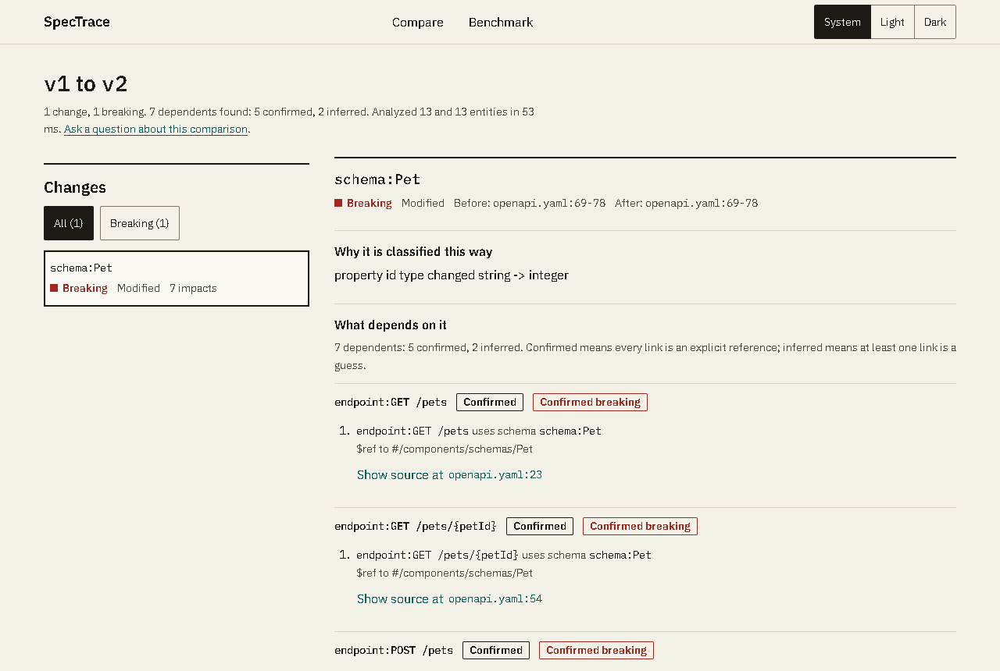
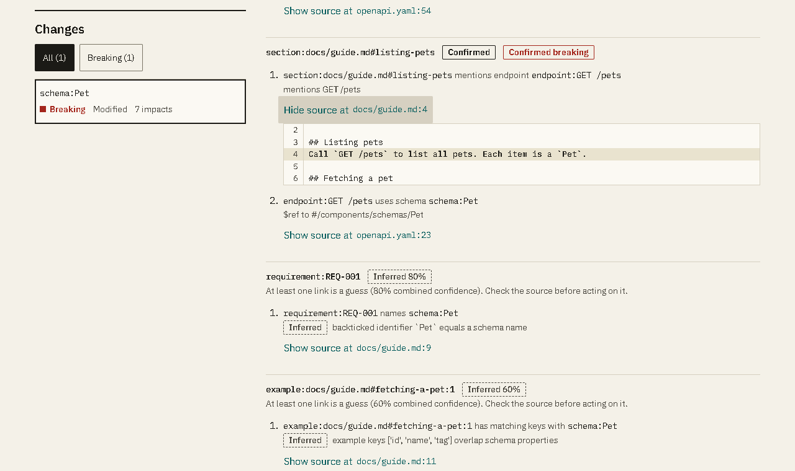
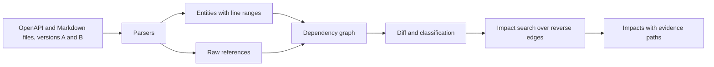

# SpecTrace

Version-aware change-impact analysis for API specifications and their documentation.

Give SpecTrace two versions of an OpenAPI file and the Markdown docs that describe it. It lists what changed, classifies each change with fixed rules, and then shows which docs, requirements, examples, endpoints and schemas depend on the change. Every dependent comes with the path that links it to the change and the source line that proves it. A link that is only a guess is labeled as a guess and is never presented as a confirmed breaking change.



## Why it exists

Retrieval over documents finds text that mentions a changed name. It cannot follow a dependency: a docs section that describes `GET /pets` depends on the `Pet` schema because the endpoint references it, even though the section never says `Pet`. After a schema change, the useful question is "what else must I re-check?", and the answer needs a trail an engineer can follow and verify.

SpecTrace builds a small dependency graph from explicit references, adds cautious guesses that it labels as guesses, and searches that graph backwards from each change.



## How it works



1. **Parse.** Endpoints, schemas, Markdown sections, requirements and fenced examples become entities with stable keys (`endpoint:GET /pets`, `schema:Pet`, `section:docs/guide.md#listing-pets`, `requirement:REQ-001`) and exact line ranges. YAML is read with a round-trip loader that keeps line numbers, and is bounded against alias bombs and deep nesting.
2. **Link.** Each reference becomes an edge, labeled **confirmed** or **inferred**.
3. **Diff.** Entities are compared by content hash. Formatting and comments are ignored. Each change is classified by deterministic rules.
4. **Trace.** From every modified or removed entity, the engine searches the reverse edges up to three links deep and keeps the best path to each dependent.

### Confirmed and inferred

| Label | Created by | Confidence |
|---|---|---|
| Confirmed | an OpenAPI `$ref`; a Markdown mention of `METHOD /path` that matches an endpoint; an anchor link to an existing section; an existing requirement ID | 1.0 |
| Inferred | a backticked name that equals a schema name | 0.8 |
| Inferred | a JSON example whose keys overlap a schema's properties (at least 2 shared keys and Jaccard similarity of at least 0.75) | 0.6 |

A dependent is *confirmed* only when every link on its path is confirmed. It is flagged *confirmed breaking* only when, in addition, a fixed rule classifies the change itself as breaking. Changes whose effect cannot be decided by rule (a requirement reworded, a parameter removed) are classified **needs review**, never breaking.

### Change classification

| Change | Classification |
|---|---|
| Endpoint or schema removed | breaking |
| Required parameter added; parameter became required; parameter type changed | breaking |
| Request body became required or changed schema; a 2xx response removed or its schema changed | breaking |
| Schema property removed, retyped, or added as required | breaking |
| Parameter or request body removed; non-2xx response removed; requirement added, removed or edited | needs review |
| Optional parameter, response or property added; property no longer required | non-breaking |
| Prose, summaries, examples | documentation only |

## Benchmark

`benchmark/v1` holds 14 synthetic cases with 26 hand-labeled dependents, split into a development set and a held-out set. The comparison is with keyword retrieval: every other entity whose text contains the changed entity's name.

| | Precision | Recall |
|---|---|---|
| SpecTrace | 1.00 | 0.96 |
| Keyword baseline | 0.87 | 0.77 |

Also measured: certainty label correct 1.00, cited line correct 1.00, confirmed claims that the labels contradict 0, impacts without a valid evidence path 0, median analysis time about 2 to 3 ms per document. The single miss is a docs section four links from the change, beyond the three-link search.

**Read these numbers with their limits in mind.** The labels were written by the engine's authors before the first run and have not been independently reviewed. The dataset is small and synthetic, and one error moves the held-out recall by 10 points. The engine was not tuned on this data. The keyword baseline was corrected once after the first run, which is disclosed in [`benchmark/v1/README.md`](benchmark/v1/README.md) together with the metric definitions.

```
cd backend
python -m scripts.benchmark                # all cases
python -m scripts.benchmark --split heldout --details
python -m scripts.benchmark --save         # stores benchmark/v1/results/<date>-<split>.json
```

## Repository layout

```
backend/      FastAPI service and the analysis engine
  app/core/       parsers, graph, diff, impact search (no web or database imports)
  app/adapters/   run store (SQLAlchemy; in-memory SQLite or Postgres)
  app/api/        HTTP routes and the rate limiter
  scripts/        benchmark runner
  tests/
frontend/     Next.js interface (see frontend/README.md, DESIGN.md, ACCESSIBILITY.md)
benchmark/    dataset v1 and stored results
samples/      petstore example used by the tests and the interface
supabase/     database migrations and SQL tests
render.yaml   Render blueprint for the API
```

## Quick start

Requirements: Python 3.13 and Node.js 22.12 or newer (24 is used in CI). Docker is only needed for a local Supabase stack.

```
# API
cd backend
python -m venv .venv && source .venv/bin/activate      # Windows: .venv\Scripts\activate
pip install -r requirements-dev.txt
uvicorn app.main:app --reload --port 8000

# Interface (second terminal)
cd frontend
cp .env.example .env.local
npm install
npm run dev                                           # http://localhost:3000
```

Without `SPECTRACE_DATABASE_URL` the API keeps runs in memory, so nothing survives a restart. Open the interface, press **Load petstore example**, then **Compare versions**.

### Database (optional, for persistence)

Runs are stored in one Postgres table, defined in [`supabase/migrations`](supabase/migrations). Row level security is enabled with no policies and the public roles are revoked, so the table is reachable only through the API's own connection.

```
supabase start && supabase test db          # local Postgres and the SQL tests (needs Docker)
supabase link --project-ref <ref> && supabase db push
```

Use the **session pooler** connection string for the API (the direct host is IPv6 only). A plain `postgresql://` URL is accepted.

## Configuration

Set through environment variables or `backend/.env` (see [`backend/.env.example`](backend/.env.example)).

| Variable | Default | Meaning |
|---|---|---|
| `SPECTRACE_DATABASE_URL` | unset | Postgres URL; unset means in-memory SQLite |
| `SPECTRACE_CORS_ORIGINS` | `["http://localhost:3000"]` | allowed browser origins, as a JSON list |
| `SPECTRACE_MAX_REQUEST_BYTES` | `12000000` | largest request body |
| `SPECTRACE_RATE_LIMIT_PER_MINUTE` | `120` | requests per client per minute |
| `SPECTRACE_RATE_LIMIT_HEAVY_PER_MINUTE` | `10` | POST requests (they run an analysis) per client per minute |
| `SPECTRACE_TRUST_PROXY_HEADERS` | `false` | read the client address from `X-Forwarded-For`; enable only behind a proxy you control |

The interface needs one setting, `NEXT_PUBLIC_API_URL`. It is visible in the browser, so it must never hold a secret.

## API

| Method and path | Purpose |
|---|---|
| `GET /health` | liveness |
| `POST /v1/runs` | compare two versions; body `{files_a, files_b, label_a, label_b}` with `{path: text}` maps; returns the run summary |
| `GET /v1/runs` | recent runs |
| `GET /v1/runs/{id}` | a run with its changes, impacts, graph and notes |
| `POST /v1/runs/{id}/ask` | `{question}`; answers from the stored comparison, or says it is uncertain when the question names no known entity |
| `GET /v1/runs/{id}/snippet?version=a\|b&file=&line=&context=` | source lines around a cited location |

Errors always have the shape `{"error": {"code", "message"}}` with a stable code (`input_too_large`, `unsupported_input`, `parse_error`, `limit_exceeded`, `rate_limited`, `invalid_request`, `not_found`, `internal_error`). Messages never echo submitted content.

Limits per version: 200 files, 1 MB per file, 5 MB in total, 200,000 YAML nodes, nesting depth 50, 20,000 entities. Absolute paths and `..` in file names are rejected.

## Security notes

- Uploaded files are untrusted: YAML is parsed with a round-trip loader (no object construction), bounded in nodes and depth, and file names are validated.
- Request size is checked before parsing, per-client rate limits apply, and validation errors are replaced by a fixed message so input is not reflected.
- Logs hold identifiers only (request id, route pattern, status, duration, error code), never file names or contents, and a filter redacts credentials in URLs.
- Secrets live in environment variables. The interface contains no database URL or key, and a test checks that none is served to the browser.
- The database table has row level security enabled with no policies.

Known gaps: no authentication, rate limits are per process and in memory, and the body-size check relies on `Content-Length`.

## Tests

```
cd backend  && pytest --cov=app --cov=scripts            # 122 tests; 2 need SPECTRACE_TEST_DATABASE_URL
cd frontend && npm run typecheck && npm run lint && npm test
cd frontend && npm run test:e2e                          # Chrome, against a real API with an in-memory database
supabase test db                                         # SQL tests (needs Docker)
```

The end-to-end suite builds the interface, starts both servers, and covers the main flow, bad input, a down or rate-limited API, keyboard use, drag and drop, the theme toggle, axe accessibility scans in light and dark, small screens and text enlargement. By default it expects a conda environment named `SpecTrace` and the system Chrome; set `E2E_BACKEND_COMMAND` and `E2E_CHANNEL=""` to use a plain Python environment and the Chromium that `npx playwright install chromium` downloads (this is what CI does).

Accessibility is checked by automated tests; no screen-reader testing has been done yet. See [`frontend/ACCESSIBILITY.md`](frontend/ACCESSIBILITY.md).

## Deployment

1. **Database.** Create a Supabase project and apply the migration (`supabase db push`). Copy the session pooler URL.
2. **API on Render.** Create a Blueprint from `render.yaml`. Set `SPECTRACE_DATABASE_URL` to the pooler URL (as a secret) and `SPECTRACE_CORS_ORIGINS` to a JSON list holding the frontend origin. The health check is `/health`.
3. **Interface on Vercel.** Import the repository, set the project root to `frontend`, and set `NEXT_PUBLIC_API_URL` to the Render URL. Then add the Vercel origin to `SPECTRACE_CORS_ORIGINS` on Render.

## Limitations

- Only OpenAPI 3 `components/schemas` references are resolved. No external or parameter references, no `allOf`/`oneOf` interpretation, and renamed entities appear as a removal plus an addition.
- Inputs are OpenAPI YAML or JSON and Markdown or plain text. There is no Git or GitHub ingestion yet; files are added in the interface or through the API.
- The inferred-link confidences (0.8 and 0.6) and the 0.75 similarity threshold are starting values, not tuned.
- Analysis runs inside the request. Large inputs are bounded by the limits above rather than queued.
- The benchmark is small, synthetic and not independently labeled.

## License

No license has been chosen yet. Until one is added, all rights are reserved by the authors.
